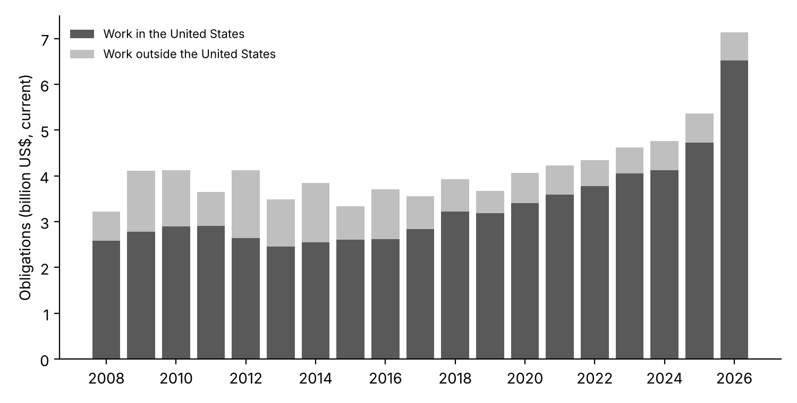
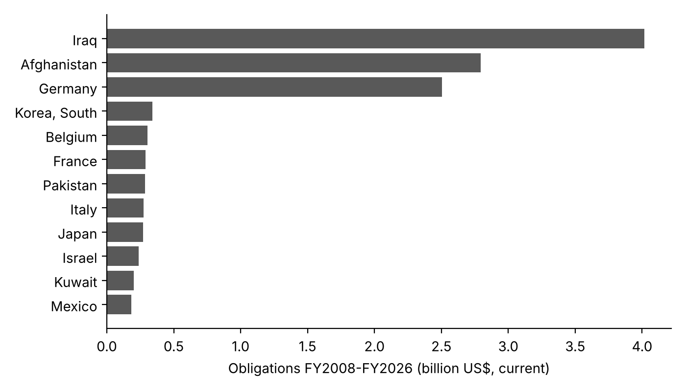

# us-guard-spending

[](https://doi.org/10.5281/zenodo.23750992)

Published by [Mercenomics](https://mercenomics.org), an independent data archive on the business of force for hire.

Every U.S. federal contract for guard services, fiscal years 2008 to 2026, cleaned and checked.

## What this project does

The U.S. government hires private companies to guard embassies, military bases, immigration detention centers, courthouses and federal buildings. Each of these contracts is reported to USAspending.gov, the government's public spending database, under the product and service code **S206 (Housekeeping – Guard)**.

This project downloads every contract action coded S206 from October 2007 to September 2026 (fiscal years 2008 to 2026), keeps the useful columns, checks the result against USAspending's own totals, and shows where the money went: by year, by country where the work was done, by agency and by company.

- **215,353 contract actions** (new awards and later changes) on **50,726 contracts**
- **$79.3 billion** in total obligations (current dollars), of which **$15.8 billion** was for work outside the United States

## What it shows



- **Spending was flat for a decade, then rose fast.** It stayed between $3.2 and $4.8 billion a year from 2008 to 2024, then reached $5.4 billion in 2025 and $7.1 billion in 2026.
- **The recent rise is driven by immigration detention.** U.S. Immigration and Customs Enforcement's guard contracts went from $1.2 billion in 2024 to $1.65 billion in 2025 and $3.29 billion in 2026. The largest recipients in 2026 include The GEO Group and CoreCivic, which run detention centers.
- **Work abroad peaked during the Iraq and Afghanistan wars.** Guard contracts performed outside the United States reached $1.0–1.5 billion in most years from 2009 to 2016 and have been about $0.5–0.65 billion a year since 2019.
- **Iraq, Afghanistan and Germany account for most of the money spent abroad**: $4.0 billion, $2.8 billion and $2.5 billion over the whole period.



- **The biggest buyers** over the whole period are the Department of Homeland Security (its central procurement office and ICE), the State Department, the U.S. Marshals Service and the Army.
- **The biggest recipients** include The GEO Group, G4S, Akal Security, Constellis, Securitas and Metropolitan Security Services. Abroad, the largest is Pond Security Service GmbH (German bases), followed by Triple Canopy and G4S.

Full tables are in [`output/tables/`](output/tables/).

## Things to know before using the numbers

- **Obligations, not payments.** An obligation is money the government commits to pay. A later change can take money back, so 18 percent of rows are negative (−$5.5 billion in total). They are kept as reported; a year's total can even be negative for one country when old contracts are closed out (Afghanistan in 2011 and 2022–2025, for example).
- **Current dollars.** Amounts are not adjusted for inflation.
- **2026 is probably incomplete for the Defense Department.** Defense contract data reach the federal procurement database with a 90-day delay, so fiscal year 2026 (which ended September 30, 2026) will rise for Defense agencies as late records arrive.
- **"Guard" is broad.** S206 covers armed and unarmed guards at home and abroad, including detention officers. It does not include other security work coded elsewhere, such as surveillance (S211).
- **Hidden names.** Some recipients appear as "DOMESTIC AWARDEES (UNDISCLOSED)" or "MISCELLANEOUS FOREIGN AWARDEES"; USAspending reports them that way.
- **Company groups.** Companies are grouped by the parent company USAspending reports for each contract action, so a firm that was later bought may appear under its old or new owner.
- **Place of performance** is where the work was done, as reported on the contract; a missing country is shown as "Unknown".

## The data

[`data/clean/s206_transactions.csv.gz`](data/clean/s206_transactions.csv.gz): one row per contract action, 29 columns (dates, amounts, agency, recipient, parent company, place of performance, contract type, competition, and the contract's description). Column definitions are in [`data/README.md`](data/README.md).

## How the data were checked

Run by [`code/02_clean.py`](code/02_clean.py); results in [`data/clean/check_against_usaspending_totals.csv`](data/clean/check_against_usaspending_totals.csv).

1. For every fiscal year, the sum of the cleaned rows matches USAspending's own published total for S206 contracts **to the cent**.
2. Every row has code S206 and a fiscal year from 2008 to 2026.
3. No contract action appears twice.

## What is here

| Folder or file | Contents |
|---|---|
| `data/raw/` | The original USAspending download (zip) and USAspending's yearly totals |
| `data/clean/` | The cleaned dataset and the check against USAspending's totals |
| `code/` | Numbered scripts, run in order |
| `output/tables/` | Summary tables |
| `figures/` | The two charts above |

## Reproduce it

Needs Python 3.13 and the package versions pinned in `requirements.txt`.

```
pip install -r requirements.txt
python code/01_download.py    # downloads from USAspending (about 10 minutes)
python code/02_clean.py       # cleans and checks
python code/03_tables.py      # tables and charts
```

The data here were downloaded on October 29, 2026. USAspending adds late and corrected records over time, so a later download can differ, especially for recent years.

## Licenses

Code: MIT (see [`LICENSE`](LICENSE)). The clean dataset: CC BY 4.0. The original data are U.S. government works from USAspending.gov and are in the public domain.

## Cite

Azom, Kazi Affnann (2026). *us-guard-spending: U.S. federal guard-service contracts (PSC S206), FY2008-FY2026* (Version v1.0.0) [Data set]. Mercenomics. https://doi.org/10.5281/zenodo.23750993

- This version (v1.0.0): [10.5281/zenodo.23750993](https://doi.org/10.5281/zenodo.23750993)
- All versions (always points to the latest): [10.5281/zenodo.23750992](https://doi.org/10.5281/zenodo.23750992)

See also [`CITATION.cff`](CITATION.cff).
